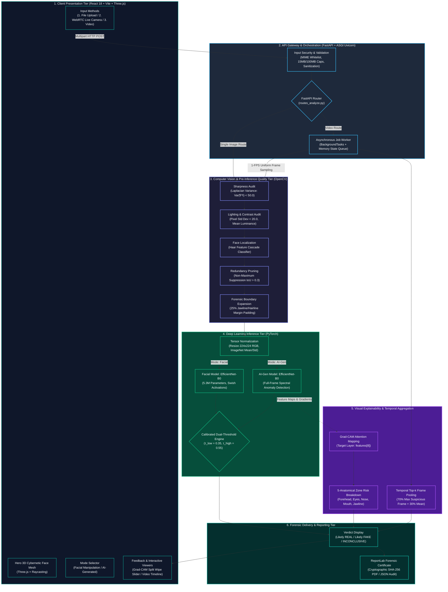
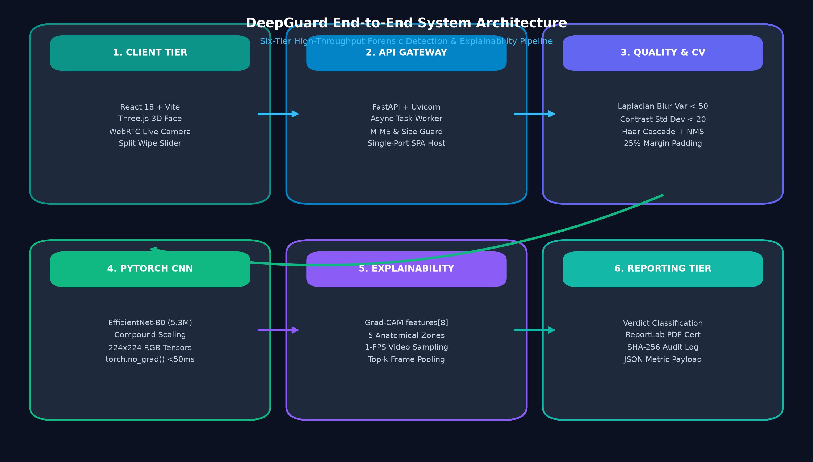
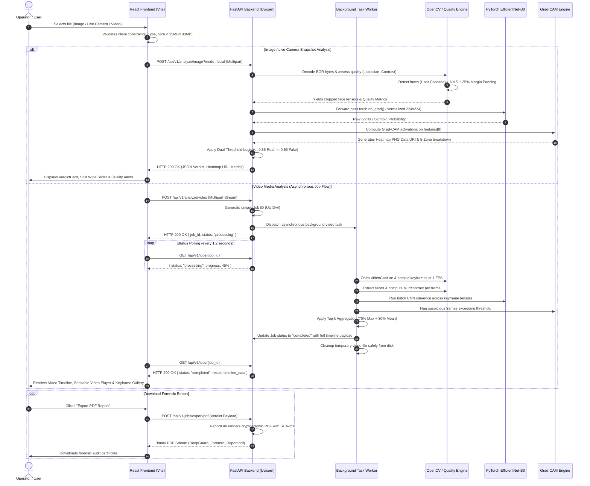
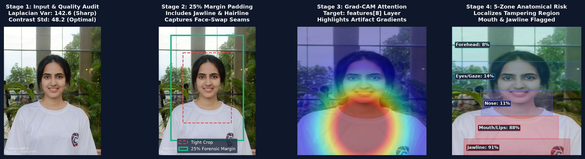
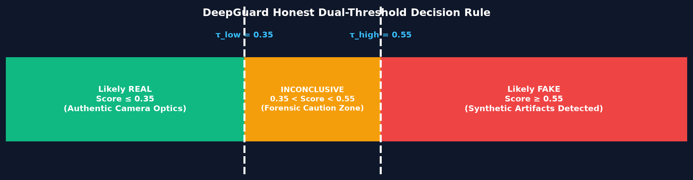

# 🏛️ DeepGuard — End-to-End System Architecture & Workflow

This document provides a comprehensive technical breakdown of the **DeepGuard End-to-End System Architecture**, data flow pipelines, component interactions, and mathematical models for final year project reports, synopses, and technical presentations.

---

## 1. High-Level System Architecture Diagram

  
   
  <em>Figure 1: DeepGuard Six-Tier High-Throughput Forensic Detection & Explainability Architecture.</em>

---

## 2. End-to-End Execution Sequence Diagram

This sequence illustrates the exact asynchronous journey of an uploaded media file from the browser through the forensic engine to report generation:

---

## 3. Detailed Component Tier Breakdown

### Tier 1: Client / Presentation Tier
- **Framework**: React 18.3, Vite 5.4, Tailwind CSS 3.4.
- **3D Hero Mesh (`Hero3D.jsx`)**: Built with Three.js. Renders an interactive cybernetic wireframe face with real-time mouse-raycasting reactivity. Utilizes `IntersectionObserver` to halt the animation loop when scrolled off-screen and pauses on `visibilitychange` when switching browser tabs.
- **Live Camera Studio (`LiveCameraCapture.jsx`)**: HTML5 WebRTC API (`navigator.mediaDevices.getUserMedia`). Provides front/rear camera toggling (`facingMode`), real-time alignment reticle, snapshot capture to canvas, and guaranteed hardware stream cleanup (`track.stop()`) on unmount.
- **Interactive Split Wipe Viewer (`HeatmapViewer.jsx`)**: Renders original imagery side-by-side with Grad-CAM heatmaps, supporting an interactive wipe slider powered by dynamic CSS `clip-path: polygon(...)`.

### Tier 2: API Gateway & Orchestration Tier
- **Framework**: FastAPI 0.100+ running on the Uvicorn ASGI server.
- **Unified Single-Origin SPA Serving**: In production, FastAPI mounts `frontend/dist` at the root `/` and handles API routes at `/api/v1/...` on the exact same host and port, completely eliminating Cross-Origin Resource Sharing (CORS) friction.
- **Asynchronous Task Architecture**: Heavy video workloads are dispatched via `BackgroundTasks`, keeping HTTP worker threads non-blocking. Progress states are tracked in an in-memory job registry.

### Tier 3: Computer Vision & Media Quality Diagnostics Tier
- **Engine**: OpenCV (`opencv-python` / `opencv-python-headless`).
- **Laplacian Blur Variance**: Computes the second spatial derivative:
  $$\sigma^2 = \text{Var}(\nabla^2 I) = \text{Var}\left(\frac{\partial^2 I}{\partial x^2} + \frac{\partial^2 I}{\partial y^2}\right)$$
  If $\sigma^2 < 50.0$, the input is flagged as motion-blurred.
- **Contrast Standard Deviation**: Computes standard deviation of pixel intensities across grayscale channels. Values $< 20.0$ trigger low-lighting advisories.
- **Haar Feature Cascade Classifier**: Detects frontal facial features rapidly across multi-scale pyramids.
- **Non-Maximum Suppression (NMS)**: Eliminates redundant overlapping bounding boxes (IoU threshold = 0.3) and sorts detected subjects by surface area.
- **25% Forensic Margin Padding**: Extends bounding boxes outwards:
  $$x_1 = \max(0, x - 0.25w), \quad y_1 = \max(0, y - 0.25h)$$
  $$x_2 = \min(W, x + 1.25w), \quad y_2 = \min(H, y + 1.25h)$$
  *Crucial scientific rationale*: Face-swap deepfakes leave tell-tale artifacts along the jawline, chin, and hair borders. Standard tight face crops cut these borders off; 25% padding forces the CNN to evaluate the transition boundaries.

  
   
  <em>Figure 2: Four-Stage Forensic Pipeline from Quality Audit and 25% Margin Padding to Grad-CAM & 5-Zone Localization.</em>

### Tier 4: Deep Learning Inference Tier
- **Framework**: PyTorch 2.0+ executed in `torch.no_grad()` inference mode.
- **Backbone Network**: **EfficientNet-B0** (5.3M parameters).
  - Uses compound scaling to uniformly scale network depth, width, and resolution with fixed scaling coefficients:
    $$\text{Depth}: d = \alpha^\phi, \quad \text{Width}: w = \beta^\phi, \quad \text{Resolution}: r = \gamma^\phi$$
    $$\text{s.t.} \quad \alpha \cdot \beta^2 \cdot \gamma^2 \approx 2, \quad \alpha \ge 1, \beta \ge 1, \gamma \ge 1$$
- **Pre-trained Checkpoints**:
  - `weights/facial_efficientnet_b0.pt`: Fine-tuned on facial manipulation datasets (FaceForensics++, Celeb-DF v2).
  - `weights/aigen_efficientnet_b0.pt`: Fine-tuned on full-frame synthetic diffusion datasets (DiffusionDB).
- **Calibrated Dual-Threshold Logic**:
  $$\text{Verdict}(S) = \begin{cases} 
  \textbf{Likely REAL} & \text{if } S \le 0.35 \\
  \textbf{INCONCLUSIVE} & \text{if } 0.35 < S < 0.55 \\
  \textbf{Likely FAKE} & \text{if } S \ge 0.55 
  \end{cases}$$

  
   
  <em>Figure 3: DeepGuard Calibrated Dual-Threshold Spectrum separating Likely Real, Inconclusive, and Likely Fake zones.</em>

### Tier 5: Explainability & Temporal Aggregation Tier
- **Grad-CAM (Gradient-Weighted Class Activation Mapping)**:
  Computes the gradient of the predicted deepfake score $y^c$ with respect to feature activation maps $A^k$ of the final convolutional layer `features[8]`:
  $$\alpha_k^c = \frac{1}{Z} \sum_{i} \sum_{j} \frac{\partial y^c}{\partial A_{i,j}^k}$$
  $$L_{\text{Grad-CAM}}^c = \text{ReLU}\left(\sum_k \alpha_k^c A^k\right)$$
  Positive gradients identify the precise facial pixels that increased the network's belief that an image is manipulated.
- **5 Anatomical Quadrants**: Bounding boxes are partitioned into Forehead, Eyes, Nose, Mouth, and Jawline/Cheeks. Mean Grad-CAM activation density is calculated per quadrant to provide per-zone risk ratings.
- **Video Temporal Pooling**: Aggregates sampled 1-FPS frame scores using weighted top-$k$ maximum pooling:
  $$S_{\text{video}} = 0.70 \cdot \max_{t}(S_t) + 0.30 \cdot \left(\frac{1}{N} \sum_{t=1}^N S_t\right)$$
  This prevents a brief 2-second face-swap insertion from being diluted by 28 seconds of authentic video footage.

### Tier 6: Forensic Reporting Tier
- **ReportLab PDF Generator**: Dynamically constructs cryptographic forensic certificates including SHA-256 hashes of analyzed inputs, model versioning, quality scores, Grad-CAM findings, and legal disclaimers.

---

## 4. Summary Table of Technologies

| Subsystem | Technology | Purpose in DeepGuard |
| :--- | :--- | :--- |
| **Frontend UI** | React 18, Vite 5, Tailwind CSS | Modular single-page application, dark/light theme, responsive controls |
| **3D Graphics** | Three.js (0.160+) | Cybernetic rotating face hero visualizer with viewport-based rendering pause |
| **Camera Studio** | HTML5 WebRTC (`getUserMedia`) | Live camera photo capture, front/rear switching, stream hardware cleanup |
| **Backend API** | FastAPI, Uvicorn (ASGI) | Async endpoints, background video worker, single-port production routing |
| **Computer Vision** | OpenCV (`cv2`) | Haar Cascades, NMS, Laplacian blur check, 25% boundary expansion |
| **Neural Network** | PyTorch (EfficientNet-B0) | 5.3M parameter compound-scaled CNN, sub-50ms CPU inference |
| **Explainability** | Grad-CAM (`torch.autograd`) | Activation heatmaps on layer `features[8]`, 5-zone anatomical risk |
| **Report Engine** | ReportLab (Python) | Production-grade cryptographic PDF forensic certificates |
| **Containerization** | Docker, Docker Compose | Multi-stage production container build (Node.js build & Python runtime) |
